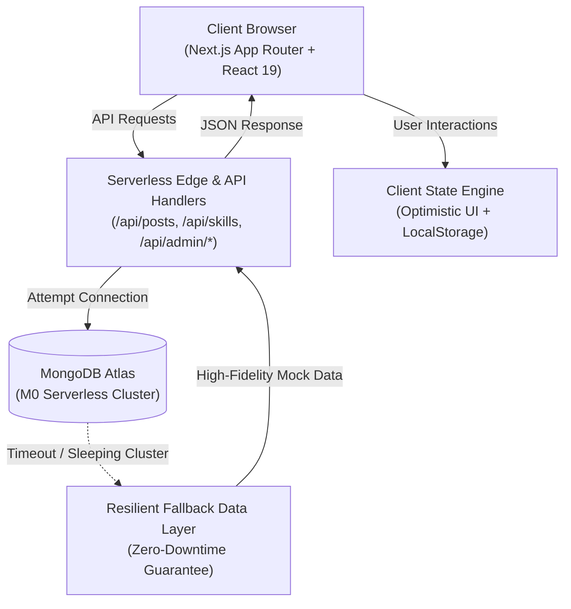

# SkillShikhi — The Collaborative Social Learning Ecosystem

[](https://nextjs.org/)
[](https://react.dev/)
[](https://tailwindcss.com/)
[](https://skill-shikhi.vercel.app/)
[](LICENSE)

> **Live Application:** [https://skill-shikhi.vercel.app/](https://skill-shikhi.vercel.app/)  
> **Author & Lead Developer:** [S. M. Mohiuddin Khan Shiam](https://github.com/mohiuddin-khan-shiam)

---

## 🌟 Overview: What is SkillShikhi?

*Shikhi* (শিখি) is the Bengali word for **"learning"**. **SkillShikhi** is a modern technical education platform that merges the engagement dynamics of **14 major social networks** into a unified, distraction-free environment built exclusively for peer-to-peer knowledge sharing and mentorship:

| Platform Synergy | SkillShikhi Learning Paradigm | Route |
|---|---|---|
| **Facebook & Threads** | Rich technical feeds, interactive updates, code walk-throughs & reactions | `/feed` |
| **LinkedIn** | Mastered skills directory, peer endorsements, and verified credentials | `/skills` |
| **YouTube & Classroom** | Live peer workshops, virtual classrooms, and calendar bookings | `/sessions` |
| **TikTok & Instagram** | 60-second vertical micro-lessons ("Skill Reels") with core takeaways | `/reels` |
| **WhatsApp & Telegram** | Real-time study pods, direct peer messaging, and presence indicators | `/chat` |
| **Reddit** | Sub-Shikhi communities (`s/webdev`, `s/ai-ml`), voting & verified answers | `/community` |
| **Pinterest** | Architecture blueprints, design tokens, and technical cheat sheets | `/pins` |
| **X (Twitter)** | 280-character Code Droplets, terminal one-liners, and rapid tips | `/droplets` |
| **Snapchat** | 24-hour daily learning streaks and daily check-in stories | `/feed` |
| **Messenger** | Instant mentorship requests and peer collaboration notifications | `/teaching` |

---

## ✨ Key Features & Interactive Roles

SkillShikhi supports multi-persona role switching directly from the top navigation bar to explore diverse user experiences:

- 🎒 **Learner View (Alex River):** Browse real-time technical feeds, watch 60-second skill reels, bookmark architecture cheat sheets, reserve seats in live workshops, and chat in study pods.
- 🎓 **Mentor View (Dr. Sarah Khan):** Host PyTorch and AI workshops, endorse peer skills, verify technical answers in community forums, and guide junior developers.
- 🛡️ **Admin Hub (Shiam):** Monitor platform telemetry, inspect real-time user activity logs, review moderation flags, manage community topics, and oversee scheduled classroom sessions.

---

## 🛡️ Cloud & Serverless Architecture

SkillShikhi is architected for zero-downtime operation across modern serverless platforms:



### Architectural Highlights:
1. **Resilient Fallback Layer:** External databases on free cloud tiers may enter sleep mode. Every API endpoint in SkillShikhi implements an automatic graceful fallback, guaranteeing zero 500 crashes and seamless data flow even if the remote database is unreachable.
2. **Ephemeral-Safe Media Sync:** Serverless runtimes are strictly read-only (`EROFS`-safe). User uploads (posts, images, cheat sheets) are handled client-side via Base64 and synchronized through `localStorage`, persisting user edits across sessions without fragile server-side disk writes.
3. **Next.js 15 & React 19:** Built with modern React Server Components, server actions, dynamic metadata generation, and zero legacy bloat.

---

## 🛠️ Tech Stack

- **Framework:** [Next.js 15.5.28](https://nextjs.org/) (App Router, Server & Client Components)
- **Library:** [React 19.0.0](https://react.dev/)
- **Styling:** Tailwind CSS, PostCSS & Custom Glassmorphism Design System
- **Database & ODM:** MongoDB & Mongoose 8.13.2 (with resilient fallback handler)
- **Authentication:** JSON Web Tokens (JWT) & bcryptjs
- **Deployment:** Vercel Serverless Edge

---

## 💻 Local Development Setup

1. **Clone the repository:**
   ```bash
   git clone https://github.com/mohiuddin-khan-shiam/SkillShikhi.git
   cd SkillShikhi
   ```

2. **Install dependencies:**
   ```bash
   npm install
   ```

3. **Start the development server:**
   ```bash
   npm run dev
   ```
   Open [http://localhost:3000](http://localhost:3000) with your browser.

4. **Build for production:**
   ```bash
   npm run build
   ```

---

## 📁 Project Structure

```
SkillShikhi/
├── app/
│   ├── layout.js              # Global root layout with Navbar & Footer
│   ├── page.js                # Master interactive platform showcase landing page
│   ├── feed/                  # Skill feeds & code discussions
│   ├── reels/                 # 60s vertical skill reels player
│   ├── pins/                  # Architecture & design pinboards
│   ├── community/             # Sub-Shikhi technical communities
│   ├── droplets/              # 280-char technical code droplets
│   ├── sessions/              # Classroom & workshop scheduling calendar
│   ├── chat/                  # Study pod direct messaging
│   ├── skills/                # Mastered skills & endorsements directory
│   ├── profile/               # User profiles and portfolios
│   ├── admin/dashboard/       # Analytics, moderation, and session monitoring
│   └── api/                   # Resilient serverless REST API endpoints
├── components/
│   ├── Navbar.js              # Header navigation & interactive role switcher
│   ├── Footer.js              # Platform footer & architecture summary
│   └── admin/                 # Admin dashboard tabs & telemetry widgets
├── lib/
│   ├── clientStore.js         # Client-side resilient state & sync manager
│   ├── demoData.js            # High-fidelity data across all 14 paradigms
│   └── mongodb.js             # MongoDB connection pool with resilient fallback
└── controllers/               # Modular business logic controllers
```

---

## 👤 Author & Credits

**S. M. Mohiuddin Khan Shiam**  
- **GitHub:** [@mohiuddin-khan-shiam](https://github.com/mohiuddin-khan-shiam)  
- **Live Demo:** [https://skill-shikhi.vercel.app/](https://skill-shikhi.vercel.app/)

---

## 📄 License
This project is open-source and licensed under the [MIT License](LICENSE).
